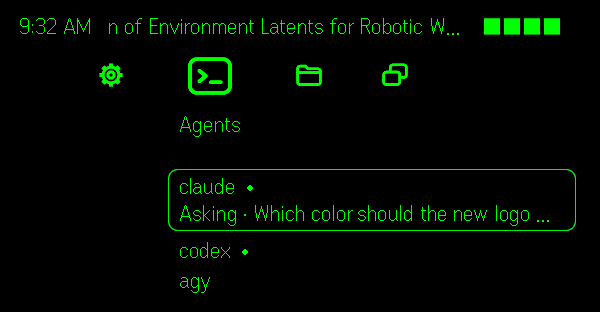
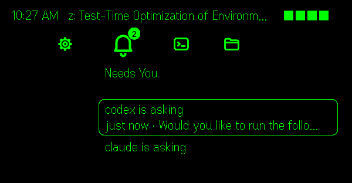
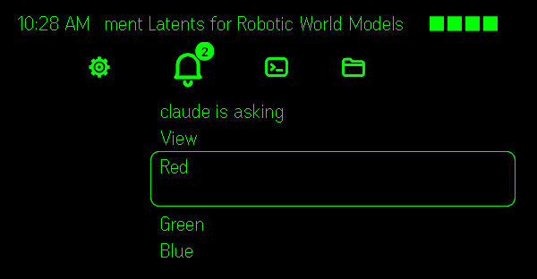
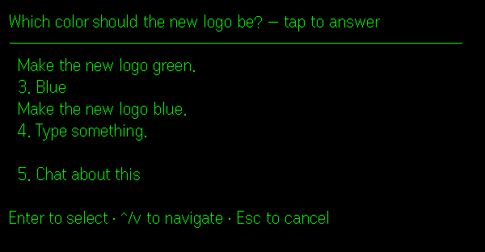
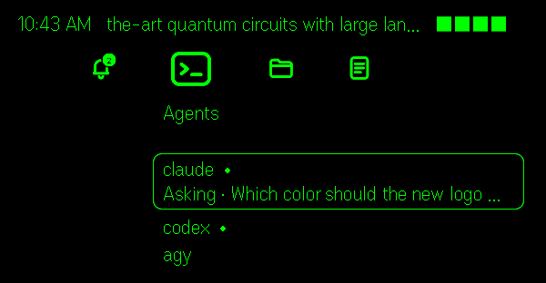
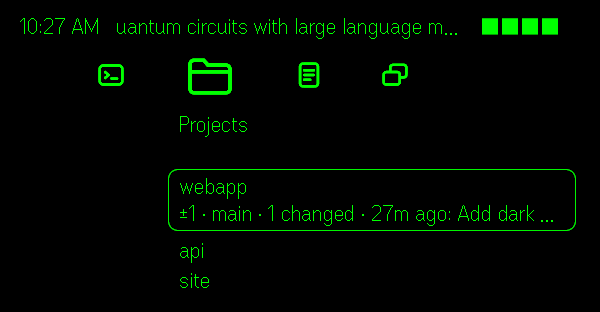
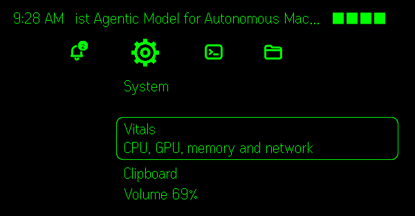

# Crossbar for Even G2

A cross-bar menu for [Even Realities G2](https://www.evenrealities.com/) glasses,
inspired by the PSP's XrossMediaBar, that keeps an eye on your Mac. Watch your coding agents (Claude Code, Codex,
Antigravity, Kimi…) running in tmux, answer their prompts from your glasses, ask them things by
voice, and browse your projects, apps, music and notes. A headline ticker you choose
scrolls along the top line.

Everything runs on your own Mac. The glasses app talks to a small bridge there, either
over [Tailscale](https://tailscale.com) (works anywhere) or on your home Wi-Fi (no
account needed). Nothing goes through a cloud service, and voice is transcribed locally
with Whisper.

<p align="center">
  
</p>

**→ Setting it up: [docs/SETUP.md](docs/SETUP.md)** (about 10 minutes).

## Screenshots

From the Even Hub simulator, with demo agents and projects.

<table>
  <tr>
    <td><br>Agents waiting on you</td>
    <td><br>Their options, ready to pick</td>
  </tr>
  <tr>
    <td><br>An agent's screen, live, with its model and folder</td>
    <td><br>Every agent and what it's doing</td>
  </tr>
  <tr>
    <td><br>Projects with their git state</td>
    <td><br>System vitals and controls</td>
  </tr>
</table>

## What it does

- **Needs You** (bell, with a count badge): agents waiting on a prompt or that just
  finished. The options of a multiple-choice prompt show up as menu items; picking one
  moves the agent's own cursor and presses Enter, and is refused if the prompt changed
  meanwhile. If you weren't wearing the glasses, you get a "While away: …" summary when
  you put them back on.
- **Agents**: every tmux pane running one of your agents, with its state and time
  ("Working · 12 min"). View it live, headed with its model, effort and folder
  ("codex - GPT-6.1-Sol ultra · ~/Documents") and what it says it's working on (its
  terminal title, sliding sideways when it doesn't fit); answer prompts, use a key strip
  (↑ ↓ Tab Enter Esc 1 2 3 y n Space Bksp ^C), **Ask** by voice (typed in after 3 s; tap
  cancels), **Snap** a photo or send one from your library to the agent, send quick
  prompts, Esc, Ctrl-C, end the agent, or start a new one.
- **Projects**: git repos under ~/Documents, ~/src, ~/code, ~/Developer, ~/Projects
  (branch, changes, ahead/behind, last commit). Start an agent in one, see its changes,
  pull (fast-forward only).
- **Notes**: your most recently edited Markdown notes (an Obsidian vault by default),
  readable page by page.
- **Running / Apps**: open, bring to front, quit.
- **Music**: Spotify now playing, play/pause, next/previous, volume, shuffle.
- **Network**: your tailnet devices (with ping) and Docker containers (logs, start,
  stop, restart).
- **System**: live vitals (CPU/GPU/memory/network sparklines), the Mac's clipboard (view
  it, copy text from your phone, paste it into an agent), volume, display sleep, log
  tails, load/uptime/disk.
- **Top line**: the time, then headlines from any RSS/Atom feeds you choose (newest AI
  papers on arXiv by default), scrolling sideways when they're long, and the glasses'
  battery.
- **Minimize**: long press shrinks everything to the bottom-left corner: the feed's
  titles, a new one every 10 s, over the time, agents needing you, the paper's number and the
  battery (inside an agent's view, the agent and its state instead of the time). Swipe
  for the previous or next title, or double-tap for the previous one; tap one to read it, and the corner (a quarter of the
  screen) fills with its title, authors and abstract. Swipe scrolls it; double-tap goes
  back to the titles. Long press again restores.

The phone shows the same Crossbar, touch-driven, plus a text box for typing into agents.
There's also a terminal version for the Mac itself: `npm run tui`.

### Controls on the glasses

| Gesture | Does |
| --- | --- |
| Swipe | move |
| Tap | open / options / do it |
| Double-tap | back (on the top level: Even's exit dialog) |
| Long press | minimize / restore (minimized: swipe moves along the titles or scrolls the paper, tap reads it, double-tap is the previous title or, in a paper, back to the titles) |

## Requirements

- Even G2 glasses and the Even app (2.2.10 or later)
- A Mac (Apple silicon or Intel) with [Homebrew](https://brew.sh), Node.js 20+ and tmux
- Either Tailscale on the Mac and your phone (same account), or both on the same home Wi-Fi
- Optional: `whisper.cpp` for voice Ask, Spotify, Docker, Obsidian

## Settings

`crossbar.json` in the repo folder (created by `bin/setup` from
[`crossbar.example.json`](crossbar.example.json)); every key is optional:

| Key | Default | What |
| --- | --- | --- |
| `agents` | `["claude","codex","agy","kimi"]` | Commands that count as agents when running in a tmux pane |
| `newAgents` | `["claude","codex"]` | Offered as "New … Here" on projects |
| `prompts` | continue, run the tests… | Quick prompts on each agent |
| `vaults` | `["~/Documents/Obsidian Vault"]` | Folders searched for Markdown notes |
| `logs` | `[".run/crossbar.log"]` | Log files you can tail from System |
| `feed.urls` | arXiv cs.AI/LG/CL | RSS/Atom feeds for the top line; `[]` turns it off |
| `feed.minutes` | `30` | Refresh interval (5–1440) |
| `feed.max` | `40` | Items kept |

The feed can also be edited on the phone (⚙ Setup). Restart the bridge after changing
`agents`: `launchctl kickstart -k gui/$(id -u)/com.g2crossbar.bridge`.

Environment variables for the bridge (`bin/setup` writes them into the login item):
`CROSSBAR_MODE` (`tailscale` or `home`), `CROSSBAR_KEY` (home mode's pairing code), `CROSSBAR_PORT`
(8787), `BIND` (override the listen address), `TAILSCALE_BIN`, `CROSSBAR_TMUX`, `WHISPER_MODEL`, `WHISPER_PORT` (8178),
`WHISPER_PROMPT`, `POLL_MS` (700).

## Privacy and security

- **Tailscale mode** (default): the bridge listens only on the Mac's Tailscale addresses,
  never on your LAN or the internet, and only answers devices owned by the **same
  Tailscale user** as the Mac (checked with `tailscale whois` on every connection), so
  other people on a shared tailnet can't use it. There's no password to leak from the app
  package.
- **Home mode** (`bin/setup --home`): the bridge listens on your home network and every
  connection needs the pairing code `bin/setup` printed (it's kept in the login item,
  readable only by you, and never built into the app package). Traffic on your Wi-Fi is
  not encrypted by Crossbar, so use home mode only on a network you trust, and prefer
  Tailscale otherwise.
- The phone app only connects to addresses that can be your Mac: `*.ts.net` names,
  Tailscale IPs (`100.64.0.0/10`, `fd7a:115c:a1e0::/48`) and `*.local` names, on port
  8787: exactly the `network.whitelist` in `app.json`. The Mac itself can always use
  `http://localhost:8787` (browser, simulator).
- It can only run the actions its own catalog offers (open/quit apps, keys into agent
  panes, git pull --ff-only…); destructive ones ask for a second tap. Keys go only to the
  pane you're viewing.
- Voice is transcribed on the Mac by whisper.cpp; photos are saved in `.run/snaps/` and
  passed to the agent as a file path.
- Your agents can do whatever you've allowed them to do. Answering their prompts from the
  glasses is the same as answering them at the keyboard.

## How it fits together

```
G2 glasses ⇄ Even app (phone: index.html + src/crossbar.ts) ──Tailscale──► crossbar-server.mjs (your Mac)
                                                                       ├─ crossbar.mjs   catalog + actions (tmux, git, apps…)
                                                                       ├─ voice.mjs speech → whisper.cpp
                                                                       └─ feed, setup, alerts
```

| File | |
| --- | --- |
| `crossbar-server.mjs` | the bridge: HTTP + WebSocket, live views, alerts, Ask, Snap, feed, setup |
| `crossbar.mjs` | the catalog: what each category lists and what its actions do; prompt detection |
| `crossbar-tui.mjs` | the same Crossbar in a terminal on the Mac |
| `lib.mjs` | Tailscale binding and owner check, shell runner, static files |
| `voice.mjs`, `text.mjs` | speech segmentation + Whisper; terminal text cleanup for the glasses font |
| `src/crossbar.ts`, `crossbar.html` | the app: glasses rendering, phone UI, setup screen |
| `src/crossbar-icons.ts` | the category icons, drawn as images for the glasses |
| `bin/setup` | one-time setup / update / `--uninstall` |
| `feed.mjs`, `src/address.ts` | headline feed parsing; which addresses the app may connect to |
| `bin/capture.mjs`, `test/` | screen capture for fixtures; the test suite |

### Developing

```sh
npm install
npm start                     # the bridge, in the foreground
npm run sim -- "http://$(tailscale ip -4):8787/"   # Even's simulator
npm run typecheck
npm test                      # unit, screen-fixture and bridge tests (Node 22.18+, tmux)
npm run capture -- agents:1.0 # save an agent's screen when its prompt is misread
```

See [docs/TESTING.md](docs/TESTING.md) for what the tests cover, how to turn a misread
prompt into a fixture, and the manual checklist for real hardware.

`npm run pack` builds `crossbar.ehpk` from `app.json` (store build: no address built in;
users enter theirs on the setup screen). `bin/setup` builds a personal one instead,
with your Mac's address in the network whitelist.

[docs/SBOM.md](docs/SBOM.md) lists everything Crossbar ships, needs and connects to;
`npm run sbom` writes it as CycloneDX JSON, and each release attaches one.

### Publishing to Even Hub

Fork it, set your own `package_id` in `app.json`, then `npm run pack` and upload
`crossbar.ehpk` in the [Even Hub developer portal](https://evenhub.evenrealities.com).

One open question for store builds: the Even app only lets an app reach hosts in
`app.json`'s network whitelist, and everyone's Mac has a different address. A personal
build (from `bin/setup`) whitelists your own Mac's exact addresses, so it always works.
The store `app.json` lists patterns (`*.ts.net`, `100.64.0.0/10`,
`fd7a:115c:a1e0::/48`, `*.local`); check with Even which pattern syntax the whitelist
actually supports before publishing.

## License

[MIT](LICENSE).

Crossbar is an independent project. Its menu layout is inspired by the XrossMediaBar
that Sony introduced on the PSX, PSP and PS3; it uses no Sony code, graphics or sounds.
"XMB" and "XrossMediaBar" are trademarks of Sony Interactive Entertainment Inc. Crossbar
is not affiliated with or endorsed by Sony, Even Realities, Anthropic, OpenAI or Google.
